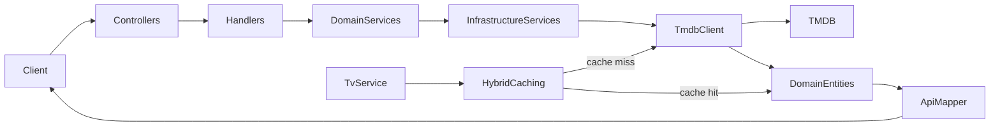

# Technical Documentation

## Overview

The application is a .NET 10 Web API that adapts TMDB responses to this
application's API models. The code is split by responsibility: the Web API
handles HTTP, the Domain defines application entities and service contracts,
and Infrastructure implements those contracts using TMDB and caching.

For setup instructions and the API contract, see the [README](../README.md).



The TV flow uses the generic `HybridCaching` helper. A successful cache hit
skips the TMDB request; a miss runs the service's factory and caches its result.

## Request flows

### Movie endpoints

```text
HTTP request
  -> MoviesController
  -> MoviesRequestHandlerFactory
  -> handler (validation where applicable)
  -> IMovieService / MovieService
  -> ITmdbClient / TmdbClient
  -> TMDB
```

`TmdbClient` deserializes TMDB-specific DTOs and maps them to Domain entities.
Handlers then use API mappers to create response models, keeping TMDB's JSON
shape and the public API shape separate from the Domain.

### TV search and caching

```text
HTTP request
  -> TvController
  -> TvRequestHandlerFactory
  -> SearchTvHandler (validates and trims query)
  -> ITvService / TvService
  -> HybridCaching.GetOrCreateAsync<TvSeriesPage>
       -> cache hit: return cached page
       -> cache miss: call ITmdbClient / TmdbClient -> TMDB
```

The cache key includes the page and query (`tv-search:{page}:{query}`), so
different queries and pages do not share results. `HybridCache` coalesces
concurrent requests for the same key within one cache instance. That
coordination is not shared across application instances.

`HybridCaching` is a generic helper and does not depend on TV types. Other
services can use it with their own key and factory.

## Project structure

```text
src/
  MovieSearchCase.Domain/
    Entities/                 Movie, TV series, pages, details, videos
    Exceptions/               Domain and API error types
    Interfaces/
      Clients/                ITmdbClient
      Services/               IMovieService, ITvService
  MovieSearchCase.Infrastructure/
    Cache/                    Generic HybridCaching helper
    Clients/                  TMDB HTTP client, response DTOs, mappings
    Services/                 MovieService, TvService
    Extensions/                Service, cache, and HTTP client registrations
  MovieSearchCase.Shared/
    IRequestHandlerAsync.cs   Common handler contract
    Extensions/               Shared options helpers
  MovieSearchCase.WebApi/
    Controllers/              Versioned HTTP endpoints
    Handlers/                 Request validation/orchestration and factories
    Models/                   Public API request and response models
    Mappers/                  Domain-to-API mappings
    Application/              Middleware, validation, versioning, Swagger, CORS
    Program.cs                Composition root and middleware pipeline
tests/
  MovieSearchCase.Infrastructure.Tests/
    Services/ Clients/ Cache/
  MovieSearchCase.WebApi.Tests/
    Handlers/
```

## API endpoints

All endpoints are versioned under `/api/v1`.

| Endpoint | Purpose | Success response |
|---|---|---|
| `GET /movies/trending` | Weekly trending movies | `Movie[]` |
| `GET /movies/search?query={query}&page={page}` | Search movies | Paginated movie results |
| `GET /movies/{id}` | Movie details | Movie with runtime, tagline, and genres |
| `GET /movies/{id}/videos` | Movie videos | `MovieVideo[]` (YouTube results) |
| `GET /tv/search?query={query}&page={page}` | Search TV series | Paginated TV-series results |

Search endpoints require a non-blank `query`. `page` defaults to 1 and must be
between 1 and 500. Search responses contain `page`, `totalPages`, `totalResults`,
and `results`. TV-series models use `name` and `firstAirDate`; movie models use
`title` and `releaseDate`.

Invalid search requests return `400`. TMDB failures are translated to the API's
problem-details error format. Errors are written with the
`application/problem+json` media type by the request middleware.

## Request validation

Search endpoints bind query-string values into `SearchMoviesRequest` or
`SearchTvRequest`. The controller actions use `[AsParameters]`, and the request
properties name the query parameters with `[FromQuery]`. `page` defaults to 1.

There are two validation stages:

1. **ASP.NET Core model binding.** `ApiControllerBase` has `[ApiController]`.
   Binding errors (for example, `page=abc`, which cannot be converted to an
   integer) make ModelState invalid, so MVC returns a 400 without invoking the
   handler. `ProblemDetailsExtensions` customizes this response using
   `InvalidModelStateResponseFactory` and sets
   `application/problem+json`.
2. **FluentValidation.** Once values bind successfully, the search handler
   calls `ValidateAsync` with `RequestAborted`. `SearchMoviesRequestValidator`
   and `SearchTvRequestValidator` in `WebApi/Application/Validations` enforce
   a non-blank query and a page number from 1 through 500. A missing query or
   `page=0` reaches this stage. Invalid values throw `InvalidRequestException`;
   `RequestLoggingMiddleware` turns it into a 400 Problem Details response.
   The service is called only after validation succeeds, and the query is
   trimmed before it is sent downstream.

The current implementation invokes FluentValidation explicitly in each search
handler; it does not use a global validation pipeline behavior.

The validators use FluentValidation because its declarative rules keep request
constraints separate from controller routing and handler orchestration. This
makes rules and error messages easy to review and unit-test, while keeping
HTTP-specific validation in the Web API layer rather than coupling the Domain
to a validation framework.

Movie detail and video routes use the `{id:int}` route constraint, so a
non-integer path segment does not match those actions. They do not currently
have FluentValidation request validators.

## HybridCache configuration

Cache options are bound from `HybridCache` in
[`appsettings.json`](../src/MovieSearchCase.WebApi/appsettings.json):

```json
{
  "HybridCache": {
    "DefaultEntryOptions": {
      "Expiration": "00:05:00",
      "LocalCacheExpiration": "00:05:00"
    },
    "DistributedCache": {
      "Redis": {
        "ConnectionString": "",
        "InstanceName": "MovieSearch:"
      }
    }
  }
}
```

When `HybridCache:DistributedCache:Redis:ConnectionString` is missing or blank,
the app registers `IDistributedCache` with in-memory storage. When it is
configured, the app registers Redis as the secondary cache. Use the environment
variable `HybridCache__DistributedCache__Redis__ConnectionString` to provide a
deployment connection string without committing credentials.

An empty connection string selects local memory. A configured but unreachable
Redis server does not trigger an application-level provider switch; no
connection-health check is configured. The Hybrid Cache's in-process primary
cache remains available, and the configured expiration values are shared by
cache consumers unless overridden per call.

## Why the architecture evolved

The initial commit (`6a7c844`) provided the weekly trending-movies endpoint:
one movies controller, one handler/factory path, `MovieService`,
`TmdbClient`, a movie model, and a small set of tests.

The current implementation extends those same layers rather than replacing
them:

- **More useful API surface:** movie search and pagination, movie details,
  movie videos, and TV-series search were added while keeping the existing
  trending endpoint.
- **Clearer boundaries:** TMDB DTOs, Domain entities, and API response models
  are distinct. Changes to TMDB's field names do not need to become public API
  changes.
- **Consistent request behavior:** search handlers validate query and page
  inputs before calling services, and upstream errors are translated into the
  API's problem-details format.
- **Reusable caching:** a generic `HybridCaching` helper centralizes cache
  access. TV search currently uses it; other services can use it without
  depending on TV-specific code.
- **Configurable cache backend:** the app uses local in-memory distributed
  cache when no Redis connection is configured and Redis when one is supplied.
  Expiration settings are also controlled through configuration.
- **More focused verification:** tests cover handlers, service forwarding,
  TMDB request construction and mapping, error handling, cache key separation,
  concurrent same-key requests, and cache configuration.

## Tests

Run all tests from the repository root:

```bash
dotnet test
```

The test projects are split between Infrastructure behavior (TMDB client,
services, and caching) and Web API handler behavior (validation and response
mapping).
